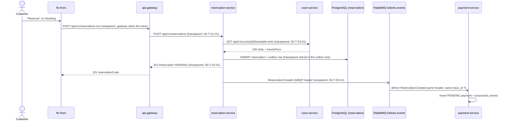

# CP1 - Critical journey and trace map

## Journey: a customer creates a reservation

A customer picks a court, a date and a whole-hour range in `ftx-front` and presses "Reservar".
The request creates a `PENDING` reservation (HU-RES-002, `createReservation` in
`07-api/contracts/openapi/reservation-service.yaml`) and, after the commit, the
`ReservationCreated` event makes `payment-service` record the `PENDING` payment (HU-PAY-002).

Why this journey: it is the core domain of Futbolix, it crosses five components and it has the
only asynchronous boundary of MVP 1. Today the team cannot follow it end to end: there is no
`correlationId` in the events and no tracing (technical debt AT-002 in
`05-architecture/overview.md`).

Sources in `ftx-docs`: `05-architecture/overview.md` (container diagram, ports),
`07-api/contracts/openapi/reservation-service.yaml` and `court-service.yaml`,
`02-domain/domain-events.md` (`ReservationCreated`, exchange `futbolix.events`),
`08-uml/diagrams/source/seq-payment.puml` (SEQ-04), ADR-006 (outbox).

## Hop table

| Step | Caller | Receiver | Protocol | Operation | Sync/Async | Data touched |
|---|---|---|---|---|---|---|
| 1 | Web App (`ftx-front`) | api-gateway :8080 | REST | `POST /api/v1/reservations` + `Idempotency-Key` | sync | none |
| 2 | api-gateway | reservation-service :8083 | REST | `POST /api/v1/reservations` | sync | none yet |
| 3 | reservation-service | court-service :8082 | REST | `GET /api/v1/courts/{id}/bookable-slots?date=` (schedule and `hourlyPrice`) | sync | `court` schema (read) |
| 4 | reservation-service | PostgreSQL | SQL | insert reservation + outbox row in one transaction | sync | `reservation` schema |
| 5 | reservation-service (outbox relay) | RabbitMQ :5672 | AMQP | publish `ReservationCreated` v1 to `futbolix.events` / `reservation.created` | async | outbox row |
| 6 | payment-service :8084 | RabbitMQ | AMQP | consume `ReservationCreated` | async | `payment` schema, `processed_events` |

Step 3 is the downstream dependency I mark for the incident drill (CP9): if court-service is
slow, every `POST /reservations` is slow, because the amount and the schedule check come from it.

## Sequence diagram with trace context

`T` is the same 32-hex `trace_id` on every arrow; only the parent span id changes per hop.

## How the context travels

- **HTTP (steps 1-3):** W3C header `traceparent: 00-<trace_id>-<parent_span_id>-01`. The browser
  sends none, so api-gateway creates the trace. Each service reads the header, creates its own
  span as a child, and writes a new `traceparent` on every outgoing call.
- **Outbox (steps 4-5):** the event is not published inside the HTTP request (ADR-006). The
  relay publishes it later, so reservation-service must save `traceparent` in the outbox row;
  otherwise the trace breaks at the database.
- **AMQP (steps 5-6):** the relay copies `traceparent` into the RabbitMQ message headers, not into
  the event payload, so the `ReservationCreated` v1 schema does not change.

## Span tree (one trace, trace_id `4c1e9a07d2b84f6e9a3b5c7d1e2f0a11`, illustrative)

- `POST /api/v1/reservations` - api-gateway, SERVER (root)
  - `POST /api/v1/reservations` - reservation-service, SERVER
    - `GET court-service /courts/{id}/bookable-slots` - reservation-service, CLIENT
      - `GET /api/v1/courts/{id}/bookable-slots` - court-service, SERVER
        - `SELECT court schedule` - court-service, DB
    - `INSERT reservation + outbox` - reservation-service, DB
    - `publish reservation.created` - reservation-service outbox relay, PRODUCER (crosses the async boundary)
      - `consume ReservationCreated` - payment-service, CONSUMER (same trace_id)
        - `INSERT payment PENDING + processed_events` - payment-service, DB

The producer and consumer spans end after the HTTP response is sent; they still belong to the
same trace because the `trace_id` travels in the outbox row and the AMQP header.

## Failure points

| Hop | Failure | What the customer sees |
|---|---|---|
| 3 | court-service timeout or 5xx | `503 SERVICE_UNAVAILABLE` |
| 3 | court not `ACTIVE`, range outside the schedule | `422 BUSINESS_RULE_VIOLATION` |
| 4 | unique constraint on the slot (no double booking) | `409 RESERVATION_SLOT_UNAVAILABLE` |
| 5 | relay or RabbitMQ down | `201`, but the payment is never recorded (reservation stays PENDING) |
| 6 | duplicate delivery | nothing: `processed_events` makes the consumer idempotent |

## Out of this trace

The checkout (`POST /api/v1/payments/checkouts` to Wompi Sandbox, SEQ-04) is a second request
made by the customer later, so it starts a new trace. Both traces are linked by the
`reservationCode`, which is logged in both (CP2).

All trace and span ids in this file are illustrative. No Futbolix service has code yet, so no
real trace was captured.
