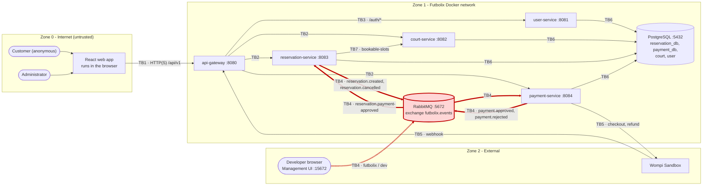

# CP1 - Attack surface and trust boundaries (Futbolix)

Sources (ftx-docs `main`): `05-architecture/overview.md`, `02-domain/domain-events.md`,
`06-data/data-dictionary.md`, `07-api/authentication.md`, `10-devops/environments.md`,
`10-devops/local-setup.md`, ADR-005, ADR-006, ADR-010.

My boundary: **TB4 - reservation-service <-> RabbitMQ <-> payment-service** (red in the diagram).
Claim issue: https://github.com/code-corhuila/ftx-docs/issues/54

> Today no service, broker or outbox exists in code (`CHANGELOG.md`, `docs/demo/mvp2-demo-script.md`).
> This map is built on the documented design, so every control below is "documented", not "verified".

## Data flow diagram

## Trust boundaries

| ID | From -> to | What crosses it | Claimed by |
|---|---|---|---|
| TB1 | Browser -> api-gateway | Customer and administrator HTTP requests | #48 |
| TB2 | api-gateway -> court, reservation, payment services | Routed requests and `X-User-Id`, `X-User-Role` | free |
| TB3 | api-gateway -> user-service | Login, refresh, logout | free |
| **TB4** | **reservation-service <-> RabbitMQ <-> payment-service** | **`ReservationCreated`, `ReservationCancelled`, `PaymentApproved`, `PaymentRejected`** | **#54 (me)** |
| TB5 | Wompi Sandbox <-> payment-service | Webhook in; checkout and refund out | #47 |
| TB6 | Services -> PostgreSQL | SQL per service database | #50 (reservation-service) |
| TB7 | reservation-service -> court-service | Availability lookup (REST) | free |

## Asset inventory (TB4)

| # | Asset | Where it lives | Classification |
|---|---|---|---|
| A1 | `ReservationCreated` payload with `customerName`, `customerEmail`, `amount` | Exchange `futbolix.events`, payment-service queue, reservation outbox | Confidential (personal data) |
| A2 | `PaymentApproved` / `PaymentRejected` (`reservationId`, `amount`, `wompiTransactionId`) | `futbolix.events`, queue `reservation.payment-approved` | Restricted (it confirms or frees a court) |
| A3 | `ReservationCancelled` (`reservationId`, `cancelledBy`) | `futbolix.events`, payment-service queue | Restricted (it triggers a Wompi refund) |
| A4 | Broker credentials `RABBITMQ_USER` / `RABBITMQ_PASSWORD` (`futbolix` / `dev` in local and develop) | Env vars of reservation-service and payment-service | Restricted |
| A5 | `reservations.status` and `payments.status` | `reservation_db`, `payment_db` (changed only by the consumers) | Internal |
| A6 | `processed_events` (idempotency keys) | `reservation_db`, `payment_db` | Internal |
| A7 | Dead-lettered messages (3 retries, 7 days retention) | DLQ in RabbitMQ | Confidential (same payload as A1-A3) |
| A8 | Outbox rows waiting to be published (ADR-006) | Outbox table of each publisher | Confidential |

## Entry points of TB4

| Entry point | Who uses it | Authentication today (documented) | Notes |
|---|---|---|---|
| Publish `futbolix.events` / `reservation.created` | reservation-service (outbox relay) | Shared user `futbolix` + password | No per-routing-key permission documented |
| Publish `futbolix.events` / `reservation.cancelled` | reservation-service | Shared user `futbolix` | Triggers a refund in payment-service |
| Publish `futbolix.events` / `payment.approved`, `payment.rejected` | payment-service | Shared user `futbolix` | reservation-service could also publish them with the same user |
| Consume queue `reservation.payment-approved` (`PaymentApprovedConsumer`) | reservation-service | Shared user `futbolix` | Idempotent by `eventId` in `processed_events` |
| Consume `reservation.created` / `reservation.cancelled` queues | payment-service | Shared user `futbolix` | Queue names not documented |
| DLQ of each queue | Operators | Shared user `futbolix` | `default-requeue-rejected: false` |
| Management UI and HTTP API `:15672` | Developers | `futbolix` / `dev` | Port published by `docker-compose.override.yml` in local and develop |
| AMQP port `:5672` | Both services | Same user | Plain AMQP, no TLS; AT-003 records no mTLS inside the Docker network |

## First observations for CP2

- One broker user for both services: anyone holding `RABBITMQ_PASSWORD` can publish `PaymentApproved`.
- Events carry no signature and no `correlationId` (AT-002), so a forged event looks like a real one.
- `security-rules.md` asks to validate the schema of consumed messages, but no consumer does it yet in the design.
- The management port `:15672` with default credentials is reachable from the developer machine.
